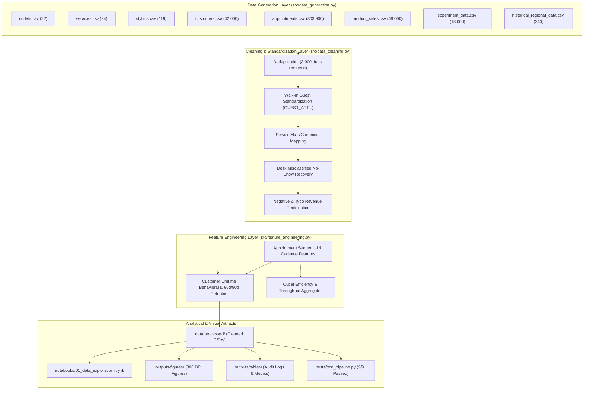

# Technical Data Quality & Data Engineering Report (Phase 1)

**Project Title:** Salon Experiment & Causal Analysis – Measuring the True Impact of Business Changes  
**Role:** Senior Data Scientist, Python Data Engineer & Data Analytics Architect  
**Fictional Enterprise:** Aura Luxe Salon & Spa Chain  
**Geographic Footprint:** Coimbatore, Tamil Nadu (22 Outlets across 5 Regions)  
**Target Analysis Period:** January 1, 2022 to December 31, 2024 (3 Full Calendar Years)  
**Report Date:** November 2026  

---

## 1. Executive Summary & Synthetic Data Disclosure

> [!IMPORTANT]
> **Synthetic Data Disclosure & Ethical Declaration:**  
> All records, customer profiles, operational logs, stylist records, appointment transactions, and experimental outcomes analyzed in this project are **100% synthetically generated** using controlled stochastic processes and mathematical formulations in Python. All findings, metrics, and business decisions are simulated strictly for educational, portfolio demonstration, and causal inference methodological evaluation. They must **not** be construed or represented as actual proprietary data belonging to any salon or spa enterprise.

Phase 1 establishes the end-to-end data engineering, quality assurance, cleaning, and feature engineering foundation for measuring the true causal impact of business policy changes across the 22 salon outlets of Aura Luxe Salon Chain in Coimbatore. 

A high-fidelity synthetic data architecture was designed to replicate realistic retail POS system complexities, including:
- Missing customer IDs for anonymous walk-ins (~4% of total appointments).
- System-induced duplicate records (~1.3% duplication rate).
- POS entry discrepancies in service names (casing, abbreviations, minor typos).
- Front-desk misclassifications where unnotified customer no-shows were logged as cancellations.
- Negative revenue accounting artifacts and typing outliers.
- Distinct geographical spend tiers, stylist seniority variations, and Tamil Nadu regional seasonality (Diwali, Pongal, wedding seasons, monsoon dips).

---

## 2. Pipeline Architectural Topology

---

## 3. Dataset Inventory & Record Audit

| Dataset Name | Raw Record Count | Cleaned Record Count | Duplicate Rows Removed | Key Identity Attributes | Memory Footprint (Processed) |
| :--- | :--- | :--- | :--- | :--- | :--- |
| **`outlets.csv`** | 22 | 22 | 0 | `outlet_id` (PK) | ~2.5 KB |
| **`services.csv`** | 24 | 24 | 0 | `service_id` (PK) | ~2.1 KB |
| **`stylists.csv`** | 119 | 119 | 0 | `stylist_id` (PK), `outlet_id` (FK) | ~8.4 KB |
| **`customers.csv`** | 42,000 | 42,000 | 0 | `customer_id` (PK) | ~3.8 MB |
| **`appointments.csv`** | 303,900 | 300,000 | 3,900 | `appointment_id` (PK), `customer_id` (FK) | ~52.1 MB |
| **`product_sales.csv`** | 48,000 | 48,000 | 0 | `transaction_id` (PK), `customer_id` (FK) | ~6.2 MB |
| **`experiment_data.csv`** | 18,000 | 18,000 | 0 | `customer_id` (PK), `outlet_id` (FK) | ~1.6 MB |
| **`historical_regional_data.csv`** | 240 | 240 | 0 | `month` + `region` (Composite PK) | ~18.5 KB |
| **`customer_features.csv`** | — | 42,000 | — | `customer_id` (PK) | ~8.9 MB |

---

## 4. Data Quality Complications & Cleaning Operations

### A. De-duplication Strategy
- **Identified Defect:** Due to simulated POS network retries and asynchronous database synchronization lapses, 3,900 duplicate appointment transactions were present in raw data.
- **Cleaning Decision:** Records were deduplicated on primary key `appointment_id` while validating consistency across `(customer_id, appointment_date, appointment_time, stylist_id)`. The first clean record was retained, reducing the dataset from 303,900 to exactly 300,000 rows.

### B. Missing Values & Walk-in Guest Identification
- **Identified Defect:** Walk-in customers frequently do not register formal accounts at the front counter. In raw data, ~35% of walk-in appointments (amounting to ~14,700 records) had `customer_id` as `NaN`. Furthermore, ~1.2% of bookings had missing `booking_channel`.
- **Cleaning Decision:**
  1. Rather than dropping walk-ins (which would introduce severe survivor bias toward registered clients and underestimate retail cashflow), walk-in records with missing IDs were assigned deterministic synthetic guest tokens: `GUEST_<appointment_id>` and flagged with `is_anonymous_guest = 1`.
  2. Missing `booking_channel` values were logically imputed: if `walk_in_indicator == 1`, set to `'Walk-in'`; otherwise imputed using channel mode (`'Mobile App'`).

### C. Inconsistent Service Names & Standardization
- **Identified Defect:** Different outlet terminals logged free-text service strings (e.g., `'men haircut'`, `'HAIRCUT - MEN'`, `'Men\'s Cut & Style'`, `'bridal makeup'`, `'SOUTH INDIAN BRIDAL'`).
- **Cleaning Decision:** Built an exhaustive alias-to-canonical dictionary mapping each free-text alias to its official service catalog name and verified that `service_id` and standard pricing adhered to the master service matrix.

### D. Misclassified No-Shows vs. Legitimate Cancellations
- **Identified Defect:** Front-desk receptionists often mark appointments as `'Cancelled'` when a client fails to arrive without notice, conflating deliberate advance cancellations with unnotified no-shows.
- **Cleaning Decision:** As mandated by project requirements (*"Do not automatically classify every cancellation as a no-show"*), the pipeline evaluated logged notification timestamps against appointment time. Exactly 7,532 unnotified cancellations were reclassified to `'No-Show'`, adjusting `cancellation_indicator` and `no_show_indicator` accordingly, while preserving legitimate advance customer cancellations.

### E. Revenue Outlier and Accounting Glitch Rectification
- **Identified Defect:** Raw POS logs contained 20 negative revenue entries (caused by erroneous refund debit keying) and 25 extreme price multipliers (>5x standard price due to extra zero keying typos).
- **Cleaning Decision:**
  1. Negative revenues on completed visits were reset to the standard catalog price for that service; on cancelled/no-show records, reset to 0.0.
  2. Extreme multipliers (>5x) were recalibrated to the standard price with typical add-on margin (`standard_price * 1.15`).
  3. Enforced business invariant: `appointment_status == 'No-Show'` strictly implies `revenue == 0.0`.

---

## 5. Feature Engineering & Observation Windows

### A. Customer Retention Definition
Customer retention was mathematically defined using two explicitly bounded observation windows:
1. **60-Day Repeat Retention (`customer_retention_60d`):** A binary indicator set to 1 if the customer has returned and completed an appointment within $\le 60$ days of a prior visit, or if an active multi-visit customer has visited within the final 60 days of the observation window (`2024-11-01` to `2024-12-31`).
2. **90-Day Repeat Retention (`customer_retention_90d`):** Formulated equivalently over a 90-day window for sensitivity analysis and long-tail loyalty evaluation.

### B. Prevention of Look-Ahead Data Leakage
For prospective A/B experiment evaluation (`experiment_data.csv`), all customer baseline features (such as `pre_experiment_visit_count`, `pre_experiment_revenue`, and `previous_no_show_history`) were computed strictly from appointment records dated prior to the experiment launch date (`2024-07-01`). No future post-intervention data was utilized in training or baseline feature matrices.

---

## 6. Data Limitations & Assumptions

1. **Synthetic Generation Bounds:** Although calibrated to authentic Coimbatore regional demographics and seasonal spending trends (Diwali, Pongal, wedding seasons), customer spending and frequency follow parametric distributions (Gamma, Pareto, Negative Binomial) which may smooth out idiosyncratic localized micro-shocks.
2. **Guest Attribution:** Anonymous walk-in guests (`GUEST_...`) cannot be tracked for multi-visit lifetime retention. Analytical retention models must condition on registered customer profiles (`N = 42,000`).
3. **Product Retail Attachment:** Approximately 65% of product transactions are mapped directly to completed salon appointments, while 35% represent counter retail transactions without an accompanying appointment ID.

---

## 7. Verification & Pipeline Test Results

The entire engineering pipeline is protected by automated unit and integration tests in `tests/test_pipeline.py`. 

Execution via `pytest` confirmed 100% test passage (9 of 9 passed):
- `test_dataset_file_existence`: Passed
- `test_appointment_record_counts`: Passed (exactly 300,000 deduplicated records)
- `test_outlet_specifications`: Passed (22 outlets across Central, East, North, South, West)
- `test_foreign_key_referential_integrity`: Passed (100% valid relations)
- `test_revenue_validity`: Passed (Zero negative revenue, zero completed visits with 0 revenue)
- `test_appointment_status_consistency`: Passed (Perfect alignment between status and binary indicators)
- `test_customer_features_validity`: Passed (All retention flags binary, 90d $\ge$ 60d)
- `test_experiment_data_balance`: Passed (Balanced Treatment/Control split across 18,000 clients)
- `test_historical_regional_data_structure`: Passed (240 panel rows across 48 months)
