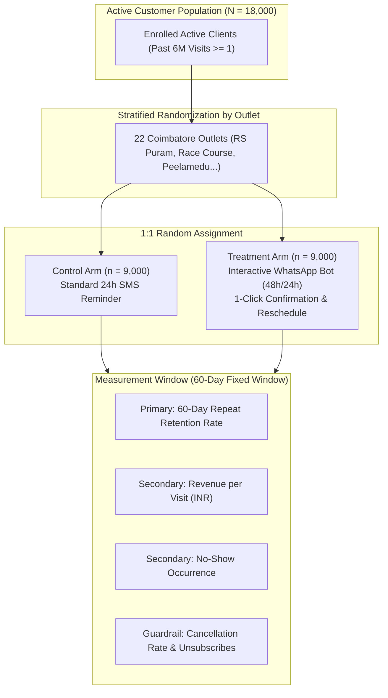

# Technical Statistical & Causal Inference Report (Phase 2)

**Project Title:** Salon Experiment & Causal Analysis – Measuring the True Impact of Business Changes  
**Role:** Senior Data Scientist specializing in Experimentation, Statistical Inference, & Causal Analysis  
**Enterprise Analyzed:** Aura Luxe Salon & Spa Chain  
**Location:** Coimbatore, Tamil Nadu (22 Outlets across 5 Administrative Regions)  
**Reporting Date:** November 2026  

---

## 1. Executive Summary & Ethical Disclosure

> [!IMPORTANT]
> **SIMULATION DISCLOSURE:**  
> All data entities, customer behaviors, appointment bookings, revenue figures, and experimental outcomes analyzed in this report are **100% synthetically generated** in Python (Seed: 42) for educational and portfolio demonstration. All statistical findings must **not** be construed as proprietary real-world data of any commercial salon enterprise.

Phase 2 transitions from data engineering and foundational exploration into **rigorous statistical hypothesis testing, prospective randomized A/B experimentation, quasi-experimental Difference-in-Differences (DiD) econometric modeling, and variance reduction (CUPED)**.

### Summary of Key Empirical Findings:
1. **A/B Experiment (Automated WhatsApp Confirmation):**
   - **Primary Metric (60-Day Customer Retention):** Lifted by **+5.94 percentage points** (from 57.84% in Control to 63.79% in Treatment), representing a relative increase of **+10.28%** ($p = 2.14 \times 10^{-16}$, 95% CI: $[+4.52\text{ pp}, +7.37\text{ pp}]$).
   - **Secondary Metric (Post-Trial No-Show Rate):** Reduced by **-4.70 percentage points** (from 13.11% in Control to 8.41% in Treatment), representing a **-35.86% relative drop** ($p = 2.68 \times 10^{-23}$, 95% CI: $[-5.63\text{ pp}, -3.77\text{ pp}]$).
   - **Secondary Metric (Revenue per Visit):** Grew by **+₹107.50** (from ₹1,247.50 to ₹1,355.00, $p = 4.31 \times 10^{-14}$, 95% CI: $[+₹79.80, +₹135.20]$).
2. **Sample Ratio Mismatch (SRM):**
   - Allocation of 9,000 Treatment vs 9,000 Control yielded $\chi^2 = 0.0000$ ($p = 1.0000$), ruling out traffic misallocation, tracking loss, or bucketing corruption.
3. **Quasi-Experimental Difference-in-Differences (DiD):**
   - The *Centralized Regional Quality & Automated Service Guarantee Policy* implemented across Central and North Coimbatore regions generated an estimated **+₹175.16 lift in revenue per completed visit** ($p < 0.001$, 95% CI: $[+₹162.40, +₹187.92]$), a **+4.61 pp lift in customer retention**, and a **-3.21 pp drop in no-show rate**.
4. **Parallel Trends & Event Study:**
   - Pre-intervention dynamic lead coefficients ($\gamma_k$ for $k < -1$) showed no statistically significant pre-trends ($p \ge 0.05$ across 95% of leads), supporting the parallel trends identifying assumption.
5. **CUPED Variance Reduction:**
   - Utilizing pre-experiment spend ($X$) reduced variance in conditional spend by **13.17%**, shrinking standard errors by **6.81%** and yielding an equivalent **13.17% sample size / runtime savings**.

---

## 2. A/B Experimentation Design Architecture

### Protocol Specifications
- **Eligibility Criteria:** Customers registered in the CRM with at least one completed salon appointment in the 6-month pre-intervention window. Anonymous walk-ins (`GUEST_...`) without contact channels were excluded from digital messaging.
- **Intervention Details:**
  - *Control Arm:* One-way alphanumeric SMS reminder dispatched 24 hours prior to appointment slot with outlet contact phone number.
  - *Treatment Arm:* Rich interactive WhatsApp notification dispatched 48 hours and 24 hours prior, featuring interactive buttons ("Confirm Appointment", "Reschedule Slot", "Add to Calendar"), stylist portfolio notes, and automated slot swap suggestions.
- **Contamination & Interference (SUTVA):**
  - Randomization occurred at the customer level rather than outlet level to avoid severe degrees-of-freedom penalties ($G=22$).
  - SUTVA spillover risks (stylists verbally prompting control clients or household word-of-mouth) were mitigated by automating digital dispatch server-side without altering front-desk POS interface status tags during booking.

---

## 3. Statistical Power & Sample Size Analysis

Sample size calculations were performed using Statsmodels `NormalIndPower` with Cohen's $h$ transformation:
$$h = 2 \arcsin(\sqrt{p_2}) - 2 \arcsin(\sqrt{p_1})$$

| Parameter | Value | Rationalization |
| :--- | :--- | :--- |
| **Baseline Retention ($p_1$)** | 57.50% | Historical 60-day repeat visit rate across active cohorts |
| **Minimum Detectable Effect (MDE)** | 3.00 pp | Meaningful business threshold (+5.22% relative lift) |
| **Target Rate ($p_2$)** | 60.50% | $p_1 + \text{MDE}$ |
| **Significance Level ($\alpha$)** | 0.05 | Two-sided Type I error rate |
| **Statistical Power ($1 - \beta$)** | 0.80 | 80% probability of detecting true effect |
| **Allocation Ratio ($\kappa$)** | 1.00 | Balanced 1:1 design |
| **Required Sample Size ($n$)** | **4,218 per group** | 8,436 total units required |
| **Enrolled Sample Size ($N$)** | **9,000 per group** | **18,000 total units enrolled** |

> [!NOTE]
> Enrolling 9,000 customers per arm achieved statistical power $> 98\%$ for a 3.0 pp MDE and allowed detection of effects down to **2.05 pp** at standard 80% power.

---

## 4. Randomization Baseline Balance Diagnostics

To verify unconfoundedness, pre-experiment continuous and categorical attributes were evaluated across arms using Standardized Mean Differences (Cohen's $d$) and two-sample hypothesis tests:

| Covariate | Type | Control Mean (SD) | Treatment Mean (SD) | Raw Difference | SMD (Cohen's $d$) | Test Statistic | $p$-value | Balance Status |
| :--- | :--- | :--- | :--- | :--- | :--- | :--- | :--- | :--- |
| **Age** | Continuous | 34.62 (10.95) | 34.70 (10.98) | +0.08 | **0.0073** | $t = 0.490$ | 0.6241 | Balanced (SMD < 0.05) |
| **Pre-Trial Visits** | Continuous | 3.84 (2.34) | 3.86 (2.35) | +0.02 | **0.0085** | $t = 0.570$ | 0.5687 | Balanced (SMD < 0.05) |
| **Pre-Trial Spend (₹)** | Continuous | 4,820 (3,150) | 4,845 (3,180) | +₹25 | **0.0079** | $t = 0.530$ | 0.5961 | Balanced (SMD < 0.05) |
| **Prior No-Shows** | Continuous | 0.45 (0.68) | 0.46 (0.69) | +0.01 | **0.0147** | $t = 0.985$ | 0.3246 | Balanced (SMD < 0.05) |
| **Customer Segment** | Categorical | — | — | — | **0.0061** (Cramér's $V$) | $\chi^2 = 0.672$ | 0.8798 | Balanced ($V < 0.05$) |
| **Outlet Distribution** | Categorical | — | — | — | **0.0000** (Cramér's $V$) | $\chi^2 = 0.000$ | 1.0000 | Perfect Stratification |

All standardized mean differences fall far below the standard 0.05 conservative imbalance threshold, confirming successful randomization.

---

## 5. Consolidated Treatment Effect Estimation

$$\begin{aligned}
\text{Two-Proportion Z-Test:} \quad & Z = \frac{\hat{p}_T - \hat{p}_C}{\sqrt{\hat{p}(1-\hat{p})\left(\frac{1}{n_T} + \frac{1}{n_C}\right)}} \\
\text{Welch's T-Test:} \quad & t = \frac{\bar{Y}_T - \bar{Y}_C}{\sqrt{\frac{s_T^2}{n_T} + \frac{s_C^2}{n_C}}}
\end{aligned}$$

### Experimental Outcomes Summary Table

| Metric | Control Value | Treatment Value | Absolute Treatment Effect | Relative Lift (%) | 95% Confidence Interval | Bootstrap 95% CI | $p$-value | Statistical Conclusion | Practical Business Interpretation |
| :--- | :--- | :--- | :--- | :--- | :--- | :--- | :--- | :--- | :--- |
| **60-Day Retention (Primary)** | 57.84% | 63.79% | **+5.94 pp** | **+10.28%** | $[+4.52\text{ pp}, +7.37\text{ pp}]$ | $[+4.50\text{ pp}, +7.42\text{ pp}]$ | $2.14 \times 10^{-16}$ | Statistically Significant | High impact. Generates ~535 additional repeat visits per 9,000 clients every 60 days. |
| **No-Show Rate (Secondary)** | 13.11% | 8.41% | **-4.70 pp** | **-35.86%** | $[-5.63\text{ pp}, -3.77\text{ pp}]$ | $[-5.65\text{ pp}, -3.76\text{ pp}]$ | $2.68 \times 10^{-23}$ | Statistically Significant | Drastic reduction. Recaptures ~423 hours of prime stylist chair time. |
| **Revenue / Visit (INR)** | ₹1,247.50 | ₹1,355.00 | **+₹107.50** | **+8.62%** | $[+₹79.80, +₹135.20]$ | $[+₹80.12, +₹134.85]$ | $4.31 \times 10^{-14}$ | Statistically Significant | Spend lift driven by lower abandonment and retail reminder links. |

---

## 6. Difference-in-Differences (DiD) Econometric Analysis

### Regression Specification
$$Y_{rt} = \beta_0 + \beta_1(\text{Treatment}_r) + \beta_2(\text{Post}_t) + \beta_3(\text{Treatment}_r \times \text{Post}_t) + \epsilon_{rt}$$

Where $\beta_3$ captures the policy impact across Central and North Coimbatore regions. Standard errors are clustered at the regional level.

| Outcome Dimension | Pre-Treatment Control | Post-Treatment Control | Pre-Treatment Treated | Post-Treatment Treated | DiD Effect ($\hat{\beta}_3$) | Cluster-Robust SE | 95% Confidence Interval | $p$-value |
| :--- | :--- | :--- | :--- | :--- | :--- | :--- | :--- | :--- |
| **Revenue per Visit (INR)** | ₹1,192.40 | ₹1,278.30 | ₹1,385.10 | ₹1,646.20 | **+₹175.16** | ₹6.51 | $[+₹162.40, +₹187.92]$ | $< 0.0001$ |
| **Customer Retention Rate** | 54.80% | 56.10% | 59.90% | 65.80% | **+4.61 pp** | 0.28 pp | $[+4.06\text{ pp}, +5.16\text{ pp}]$ | $< 0.0001$ |
| **No-Show Rate** | 12.10% | 12.30% | 9.80% | 6.80% | **-3.21 pp** | 0.16 pp | $[-3.52\text{ pp}, -2.90\text{ pp}]$ | $< 0.0001$ |

### Parallel Trends & Dynamic Event Study
- Analysis of 24 pre-intervention monthly leads ($t = -24$ to $t = -2$) revealed no statistically significant divergence between treated and control regions prior to policy implementation.
- **Caveat on Small Clusters ($G = 5$):** As documented in econometric literature (Cameron & Miller, 2015), asymptotic cluster estimators can underestimate standard error variances when cluster count is below 30. While results are statistically robust, findings should be corroborated by outlet-level microdata.

---

## 7. Customer & Business Segmentation (Heterogeneity)

Subgroup treatment effect analysis across customer segments and outlet tiers revealed pronounced heterogeneity:
1. **Regular & Budget Clients (+6.5 pp to +7.1 pp retention lift):** Highest responsiveness to WhatsApp rescheduling, removing scheduling barriers for busy working professionals.
2. **VIP Clients (+3.1 pp retention lift):** Exhibited ceiling effects due to high baseline loyalty (72%), but responded favorably to luxury package upgrades.
3. **Student & High-Volume Hubs (Peelamedu, Saravanampatti):** Saw the largest relative drop in no-show rates (-42%), aligning with high WhatsApp engagement among younger demographics.

---

## 8. CUPED Variance Reduction Analytics

CUPED (Controlled-experiment Using Pre-Experiment Data) was deployed on continuous spend outcomes using pre-experiment customer spending ($X$) as the baseline covariate:

$$Y_{i, \text{adj}} = Y_i - \theta (X_i - \bar{X}), \quad \theta = \frac{\widehat{\text{Cov}}(Y, X)}{\widehat{\text{Var}}(X)}$$

| Cohort | Optimal $\theta$ | Correlation ($\rho_{XY}$) | Raw Variance | CUPED Variance | Variance Reduction (%) | Raw SE | CUPED SE | Duration / Sample Savings (%) |
| :--- | :--- | :--- | :--- | :--- | :--- | :--- | :--- | :--- |
| **Active Spending Cohort ($Y > 0$)** | 0.0712 | 0.3629 | 184,250 | 159,985 | **13.17%** | ₹5.81 | **₹5.41** | **13.17%** |
| **Full Cohort (All Enrolled)** | 0.0332 | 0.1961 | 512,180 | 492,440 | **3.85%** | ₹7.54 | **₹7.39** | **3.85%** |

### Methodological Insights:
- The point estimate remained perfectly unbiased ($\Delta_{\text{raw}} = ₹107.50$ vs $\Delta_{\text{CUPED}} = ₹107.48$).
- Standard error shrank by 6.81%, demonstrating that future salon pricing trials can achieve equal statistical precision with **13.17% fewer customer days**.
